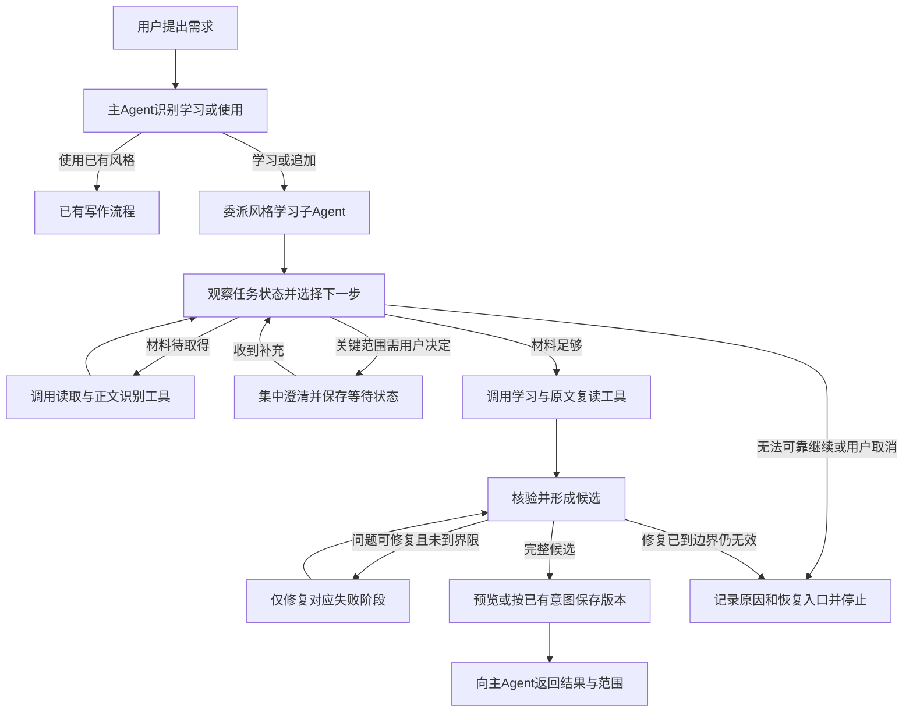

# Cognitive Writer 产品需求文档

文档版本：v0.3 · 更新日期：2026-11-03 · 产品负责人：khlilo。本文为当前产品需求入口，本次重点更新风格学习子 Agent 与产品输入链。

状态：已按文档先行完成P1技术设计、P2来源工具和P3材料领域Agent开发链；P3终点为ready_for_learning，真实检查与两次失败及有界修正已留证。P4主会话调度、P5学习／保存／Writer交接、P6格式补齐和P7/P8质量／采用仍未完成。正文核心基线b6e4827、P1/P2基线3bf5349；本轮P3事实见阶段报告和同次实现提交，不代表正式产品发布。

执行顺序见[行动计划](plans/2026-11-03-style-learning-agent-plan.md)。历史实验目标保留在[2026-10-23产品目标](../research/style-aggregation/product-goal-2026-10-23.md)；涉及当前产品行为时以本文为准，历史原始输入、回执与结论不追改。

## 1. 产品要解决什么问题

Cognitive Writer 是面向微信公众号与个人网站写作的 Rust 对话式 Agent。用户通过自然语言提出写作、修改、学习风格或使用已有风格的需求，系统组织工具与模型完成对应任务，并让用户掌握候选、保存和发布的关键选择。

风格学习的价值是：把用户指定的一篇或多篇文章中有依据的写法，转成详尽、可信、能被 Writer 在新题材中使用的风格说明。单篇和多篇都要独立可用；追加文章可以修正原先推断。比较用于发现失真和误伤，不用于证明“多篇获胜”。

成功既需要完成任务，也需要控制用户负担。系统能自行解决常规问题，能对关键缺口集中提问，能在信息足够时交付，也能明确说明确实无法完成的部分。详尽程度按表达需要决定，不用字数、固定十维栏目或模型自评分替代质量。

## 2. 当前能力与缺口

以下为本轮P3结束后的状态；“实现”不等于“质量全面通过”。

|能力|当前状态|依据与剩余工作|
|---|---|---|
|自然语言写作、全文与局部修改、风格选择、保存恢复和发布流程|既有能力，本轮不重设计|既有CLI/REPL；发布继续遵守用户明确意图。|
|旧单篇URL学习与命名|已有独立入口|默认direct_free；不是下述子Agent产品入口。|
|1–10篇正文学习与原文复读|开发核心已实现|voice-core-v6 / voice-reviewed-v3；引用归属已核验，不证明全部概括含义正确。|
|候选预览、命名版本、历史、差异与纯spec导出|开发工作区已实现|style-draft；复用现有版本机制，不能重新列为待开发基础设施。|
|正文新建、追加、阶段恢复与费用留证|开发任务链已实现|真实单篇→双篇链已完成；输入是正文包，不是用户文章文件或网址集合。|
|文件／URL取得正文、数量选择和范围澄清|P2采集及P3领域范围决策开发入口已实现|支持TXT/MD／正文／URL来源工具；真实模型小试为合成正文，开放网络质量仍待补验。|
|主Agent分派、风格学习子Agent自主处理|P3材料决策Agent已实现；主Agent分派未接|agent-start等开发命令可动态选工具，终点为材料就绪；P4/P5仍待接。|
|有限追问、等待与恢复、取消和主会话协作|P3任务级已实现验证；P4主会话协作待做|最多两轮、12步、两次无进展、一次Pro升级；迟到结果不采用，已问已答可恢复。|
|当前方法的高篇数质量与重要概括语义可靠性|未全面验收|历史1/3/10篇曾跑通，不能当作core-v6的10篇真实质量结论。|
|新题材执行与Writer事实遵守|局部边界可执行，仍有明确缺口|四稿保留感受／抽象论证边界；各稿仍有事实或推理越界。|

事实记录见[正文任务](2026-10-31-learning-jobs.md)、[工作区](2026-10-31-learning-workspace.md)、[来源关卡](2026-11-02-grounded-style-analysis.md)及[方法29报告](../research/style-aggregation/reports/learning-grounded-2026-11-02.md)。

## 3. 首版范围与产品边界

首版采用主Agent＋一个风格学习子Agent的职责划分，先完成一条真实可用的任务链。角色可以在同一进程中运行；子Agent不等于另开终端、线程或每个节点各建一个Agent。

范围包含：新建风格学习、向指定风格版本追加文章、材料读取与选择、必要澄清、学习候选、预览差异、命名保存、恢复，以及用户明确要求时衔接已有写作流程。有效文章数为1–10；追加时旧来源与新来源合计不超过10。

第一条开发竖切支持TXT/MD文件、直接提供的正文和单篇文章URL；首版产品验收再补DOCX与可提取文字的PDF。混合文件与网址进入同一来源清单。扫描件OCR、复杂排版还原、批量爬全站、云端文库、多个专家Agent团队、通用图运行平台及Python迁移不属于首版。对未支持格式明确说明一次可操作的替代输入方式，不循环要求用户换格式。

系统学习的是这些材料呈现的声音。没有必要鉴定真实作者身份、收集完整生平或证明作者所有作品都如此。不同题材不自动意味着不能综合；用户明确要求综合不同声音时，按该目标处理并保留差异，不强行把材料认定为同一作者的固有风格。

## 4. 用户任务与需求编号

|编号|用户要完成的事|产品要求|
|---|---|---|
|SL-01|“学一下这篇／这几篇的写法”|主Agent识别学习意图，带目标与已知材料委派；材料足够时不先访谈。|
|SL-02|“用已有风格写一篇”|进入风格使用与写作流程，不触发学习；风格缺失时走已有选择／澄清。|
|SL-03|“先学，再用它写文章”|拆成有依赖的学习和写作任务，保留原写作要求；只将可用候选或指定已保存版本交给Writer，不自动发布。|
|SL-04|文件、正文、文章网址或其混合|取得完整可读正文，保留来源快照、获取结果及文章边界，不把目录页当文章。|
|SL-05|选择篇数和材料范围|尊重明确数量；未指定数量且给定集合清楚时使用该集合，不重复问“学几篇”；去重后1–10篇。|
|SL-06|材料歧义或部分失败|按第6节的追问边界处理；不默默遗漏用户指定材料，不用无法读取的内容冒充已学。|
|SL-07|子Agent自行推进任务|能根据状态选择工具、判断是否需澄清、处理可恢复问题并结束任务；确定性工具负责硬边界。|
|SL-08|得到单篇／多篇风格说明|说明写法、条件、差异与未知；内部分析和证据独立保存，Writer只接执行Markdown。|
|SL-09|查看、命名、保存学习结果|先形成可恢复候选；用户要求保存时保存明确版本，不覆盖旧风格，不把保存当质量认证。|
|SL-10|追加学习并了解变化|从指定旧版本取回原文整体重学，展示来源增量、说明差异与有据变化理由；旧版可回看。|
|SL-11|中断、取消、换目标后继续|保存任务状态，恢复不重新问已答问题；目标变更记入任务修订，不混用旧候选。|
|SL-12|了解进展、失败和费用|展示当前动作、需用户处理的缺口、结果范围和费用状态；失败有明确原因与恢复入口。|
|SL-13|把风格用于新文章|新旧风格读取方式兼容；Writer不看到学习原文、内部分析、复读或证据数组。|
|SL-14|结果可信且不会为文风编造|重要概括有原文解释，不把可选手法变禁令；Writer事实检查独立于风格判断。|
|SL-15|少等待、少被打断|零澄清完成正常输入；工具可查的问题先查；相同阻塞点不反复追问、失败不无限重试。|
|SL-16|以后能追溯为何这样开发|需求→设计→计划→实现提交→验证→阶段结论形成记录链；产品文档先于代码。|

## 5. 主Agent与风格学习子Agent的协作

### 5.1 职责划分

主Agent拥有整体对话和顶层任务顺序，负责识别学习／使用／组合意图、创建委派、关联用户后续回复以及接收结果。子Agent拥有风格学习任务的领域判断：理解目标、检查材料、选择工具、决定是否需要问题、组织学习与候选操作。来源读取、哈希、计数、引用匹配、预算、原子保存由工具执行，不让模型凭意愿跳过。

只保留一个用户对话入口。子Agent产生的澄清经主会话呈现，回复回到同一学习任务；主Agent不重复问一遍，也不替子Agent偷偷改变材料范围。复用现有唯一stdin读取方式，不能给子Agent增加第二个终端输入读取器。

首版同一会话最多一个活跃风格学习任务；用户提出另一个学习目标时，先按明确表达暂停／替换或另存任务，而不是启动两个子Agent同时争夺回答与保存目标。并发采集等内部优化不影响这个用户任务边界。

### 5.2 委派、上下文与返回合同

委派至少携带：原始学习需求、已知目标、来源引用与用户指定数量、已有风格的明确版本、已回答的信息、保存意图、后续写作需求引用、任务预算。主Agent不必把整段历史和所有文章重复塞进每次决策。

子Agent持有独立任务状态；传回的是任务状态、候选／版本引用、已用与未用来源、澄清问题或失败原因、限制、费用。完成不只是一段自然语言，主Agent须能区分完成、待用户、失败、取消和有明确范围限制的结果。

任务短期状态与命名风格长期版本分开。文章里的命令和网页提示只作为材料，不得改变工具权限、系统规则或学习目标。子Agent可以决定调用哪些获准工具，不能自行取得发布、覆盖旧版本或搜索替代文章的额外授权。

### 5.3 组合任务的用户体验

“学完后写一篇”不要求用户重新说一遍文章要求。候选完整且满足结构／来源合同、用户已明确允许临时使用时，可用候选写草稿；并不等于保存到正式风格库。需要命名复用或用户明确指定已保存风格时，使用准确版本。质量检查失败的候选不能通过临时使用绕开阻断。

命名保存与发布是独立动作。如果用户已明确说“学完保存为X”，记录这项意图，候选满足保存合同后无需重复询问同一个保存决定；未指定名称时先交付未命名候选，命名不阻塞学习结果。发布继续由现有明确发布意图控制。

## 6. 追问边界与信息足够的判定

### 6.1 三种决定

每次决定追问前，子Agent先判断：信息缺口是否会实质改变学习目标、采用的正文或结果可信依据；现有上下文和工具能否自行消除它；继续处理是否需要替用户作关键选择。不得仅因存在未知就询问。

- **直接继续**：目标、材料边界和有效正文已足够，剩余未知只影响细节或表达把握；必要时把有限假设随结果说明。
- **集中澄清**：会改变目标或来源集合，工具无法判断，需要用户作选择。说清一个核心缺口、它的影响及可选处理，合并同批已知阻塞。
- **明确受阻或结束**：没有可学习正文、范围关键问题在澄清后仍未解决、技术尝试已到边界。保留已得材料和一次可操作的继续方式，不假装完成，也不继续盘问。

### 6.2 首版默认边界（设计提案，实施前以对话案例复核）

正常输入应为0轮追问。一次任务默认至多1轮集中澄清；仅当用户回答带来了新的必要信息、再问确实能解决阻塞时，允许第2轮。首版主动澄清总计最多2轮，同一已回答问题不重复；命名或确认不能用来绕开这个限制反复询问。

到达边界后，有不改变目标的合理处理就继续并说明；否则进入明确的待用户状态，给出已完成／缺少什么和可选下一步，停止主动追问。等待本身不运行模型或消耗重试。用户主动补充后可继续，但不能自动清零计数重开访谈。用户明确改目标时记新修订，并重新判断是否真的需要问题，不靠改任务ID绕限。

篇数是文章数量约束，不是访谈步骤。用户未指定数字、已经提供清楚的两篇文章时就学这两篇；不要求先提供作者名、平台、目标读者和固定分析维度才能开始。

保存确认沿用已给意图；未命名候选可以交付。必要的版本冲突选择不算“学不到就多问几轮”的借口：保留候选并说明冲突，让用户选择操作，不形成无限命名循环。

### 6.3 场景决策表

|输入／发现|默认动作|必须守住的边界|
|---|---|---|
|一个清楚的文章URL，正文可读|直接学习|不再问是否文章、是否确认学习或作者是谁。|
|两个完整文件，“学习这两篇”|直接按集合学习|不反复确认数量；差异本身交给学习过程分析。|
|同一页面含多篇独立文章，未指明目标|列出已识别标题／范围，集中问选哪篇或哪些|不能默认首页第一篇或偷偷学习整页。|
|目录页但用户已明确选择其中标题|查找并读取对应文章，成功就继续|用户已经选过目标，不重新问“学哪篇”。|
|页面只有登录、导航或商品信息，无法定位用户要学的文章正文|先检查已明确目标能否取得；没有可学正文时集中说明并给补正文／具体文章链接的方式|不把导航文案当文章，不因HTTP成功就宣称可以学习；已有可读正文不因缺“文章”标签被拒绝。|
|几篇署名／题材不同但用户明确要求综合|按用户目标综合，标明跨来源差异|不把不同署名自动判为无效，不进行作者身份调查。|
|几篇声音明显冲突且用户未说明想综合还是分别学|问一次目标范围|不能替用户选“最像”的文章，也不能拆成多个风格后冒充原需求。|
|部分URL无法访问，用户明确要全部或指定数量|有界获取后集中说明失败来源，问补材料还是改变范围|未得到范围变更就不能按成功的少数冒充完整集合。|
|用户已说“能读到的先学”|对可读且有效材料继续，报告实际范围|没有任何有效材料则受阻；明确篇数仍优先，不能私自违背。|
|重复文章／同文不同链接|逐篇列出去重结果，继续有效独立集合|用户明确要求的独立篇数因此不足时才澄清；不把重复算多篇。|
|去重后超过10篇，或追加后总数超过10|给出候选清单，请用户选范围|不按输入顺序静默截取，不覆盖旧版以腾位置。|
|正文很短但确实可分析|学习可见写法并说明覆盖有限|不凭字数认定不是文章，也不要求凑长才能学。|
|长文超过当前模型可处理范围|先检查可用处理路径，无法完整处理则说明并让用户选范围／换材料|不静默截断、不先摘要再声称分析了全文。|
|扫描件／不支持格式|说明当前能力，给一次文本文件或可读链接替代方式|首版不启动无界OCR／格式修复链，也不猜正文。|
|用户说“你决定”|承担可逆常规选择；对需要擅改学习对象的缺口说明仍缺什么|这不等于授权换文章、补正文或忽略数量。|

## 7. 产品输入链

每个来源经过“登记→取得→识别正文边界→去重与计数→范围足够判定→冻结有效正文”。获取成功必须表示拿到了正文，而不是HTTP成功、登录页可见或抓取器返回一段文字。

来源清单保留：用户提供的定位、文件名／URL、原始快照或可审计引用、取得时间、提取方法、获取状态、正文哈希、文章边界、是否纳入及原因。一个文件／网页可能含多篇，不把来源数等同文章数。

模型可以帮助识别文章边界和语义歧义；确定性检查负责空文、重复、支持格式、数量及数据完整性。用户材料中的链接不自动授权爬取整个站点；必要时仅沿用户指定目标获取对应正文。获取失败不自动搜索另一篇相似文章替代。

已知失败不重复使用同一路径碰运气。首版每来源自动获取最多2次有区别的尝试，例如常规读取与已有备用读取；登录／权限缺失、确定不支持格式不进行无意义重试。失败后保留原因，按第6节收束。技术重试与对话追问分别计数。

## 8. Agent工作链路与结束条件

以下是产品状态与职责示意，不是已写好的Rust API，也不是要求照搬框架。

Agent的自主性在于根据观察选择工具、组织澄清和决定下一步；已经明确的分析／编译／复读等可靠步骤可以继续作为工具内部工作流。每个节点都调用模型、固定脚本包装成“Agent”，都不能单独证明这个产品设计成立。

状态至少区分active、waiting_input、candidate_ready、saved、blocked、failed、cancelled。blocked表示有明确外部缺口及继续条件，failed表示本次处理没有有效结果；都不能仅写“暂停”而不交代原因。候选可用与保存成功分开，保存成功与质量已审分开。

任务完成需要：实际来源范围明确；候选／版本可引用；未完成项和限制清楚；结果已交回主会话。用户取消、确实无法继续或到预算边界也是明确结束／等待状态，不靠继续生成填满结果。

## 9. 恢复、循环和资源边界

每次澄清、工具结果及模型阶段成功后保存必要状态。恢复必须能重建已选来源、用户回答、待决问题、已有回执、候选和版本基准；不重新问已答问题，不重复保存版本，不因重启重复付费调用。

副作用由工具执行并校验身份：同一保存动作只能产生一次版本发布；完成请求按原身份恢复；发出却无回执的请求保留未知用量。沿用已有未知阶段最多3次显式尝试的合同，不自动重发未知付费请求。

首版子Agent决策循环默认最多12步，指观察后选择工具／澄清／结束的决策次数，不含一个学习工具内部既有阶段；等待用户不占用运行步数。连续2次没有新材料、状态变化或可执行进展时提前收束。达到边界时交付可用范围或明确阻塞，不能擅自新增Agent、延长预算或改目标继续。

批量采集工具可以一次处理来源清单，不强迫每篇都增加一次模型决策；正常10篇材料不能仅因逐篇调用开销被错误判作无进展。

12步、2轮澄清等是首版防止无界循环的设计值，不是用户刚性要求或已验证最优参数。P1用第12节对话走查检查是否过严；以后更改须先改文档并记录原因，不能实现时暗改。

## 10. 学习、版本与Writer的质量合同

单篇说明本篇可见写法与未知，多篇解释共同机制、变体和条件，不把差异抹平成通用写作建议。详尽说明视角、材料、组织、句段、判断、情绪与落点之间怎样起作用，章节自然安排。不得搬入源文故事、地名、论点或改词后的事件模板。

沿用原文分析与执行说明分层、来源引文核验、有界修复、复读与候选。引用存在只是最低证据归属要求，重要概括仍要核对含义、限定强度和反例。内部证据不需要为了机器校验变成Writer的固定栏目。

复用现有工作区的新建、追加、差异、历史和保存合同。用户可查看模型自动稿、后续修订的来源；程序不能仅凭文字diff编造变化原因。重名、旧基准过期或并发冲突保留候选，不覆盖旧版。正式风格库接入方式在P1技术设计中确定，必须能读取指定版本的纯spec并保持历史Markdown兼容。

风格学习质量与Writer事实遵守分别报告。已知四稿的无依据因果、流程和机制要作为事实检查的具体案例。先以明确的原始事实核对成稿，保留原稿与修订差异；不得为了像某种文风而补经历。没有解决事实问题的稿不能作为自动发布就绪结果。

语义／事实缺口不阻塞低风险输入工具和开发入口的建设；会阻塞“质量稳定”“正式默认已替换”“自动可发布”等采用结论。不得以此重开无限提示词分支，也不能把这些缺口从待办删除。

## 11. 验收分层与发布条件

|层次|最低验收要求|当前状态|
|---|---|---|
|任务流程|正常材料0澄清可完成；关键歧义有界澄清；恢复不丢回答；结束状态准确|现有底层有基础，新子Agent未验收。|
|来源与证据|实际文章范围正确；失败与未纳入材料可见；引文属于对应原文；重要概括语义有据|归属检查已有，产品输入与全面语义仍待验。|
|版本与增量|追加保留旧来源、版本可回看、差异与理由可解释、恢复不重复保存|底层已有，子Agent交接待验。|
|新题材执行|单篇、多篇各有自然用稿；不搬源文、不被局部手法卡死、事实问题独立识别|已有局部改善，不能宣称全部通过。|
|正式产品集成|CLI/REPL到候选、保存、再写作完整；旧功能回归；阶段文档与证据齐全|未完成，不切默认。|

开发入口可分阶段验证；正式采用需上表相关条件通过并记录采用决定。人工盲测是可选补充，不是当前研发持续推进的前置条件；若使用，先更新目的和问卷，不能拿旧失效问卷当新功能验收。

## 12. 关键验收案例

下表定义应有产品行为，不是全部通过的测试清单。P1已走查，P2仅完成其中输入工具子集的运行验证；主子Agent及完整场景仍待后续阶段。实际范围以行动计划与阶段审计为准，语义效果另作少量真实检查。

|案例|输入／故障|预期行为|关联需求|
|---|---|---|---|
|A01|清楚的单篇URL|0澄清，正确正文到候选|SL-01, SL-04, SL-15|
|A02|两篇TXT/MD文件|0澄清，来源保留，篇数为2|SL-04, SL-05|
|A03|“用X风格写文章”|不启动学习子Agent|SL-02|
|A04|“学这两篇，再写指定题目”|学习后保留原写作需求并衔接，不泄漏原文|SL-03, SL-13|
|A05|一页多文且目标未定|集中问选文，恢复后不再问相同问题|SL-06, SL-11|
|A06|目录页已指明标题，或页面只有导航且无目标正文|前者找到目标后直接处理；后者说明缺口并集中澄清，不把非文章当正文|SL-04, SL-15|
|A07|明确要5篇，2篇失败|不能默默只学3篇，给补材料／改范围的选择|SL-05, SL-06|
|A08|已允许只用可访问文章|有有效正文就继续，结果列出范围和失败项|SL-06, SL-12|
|A09|重复来源造成篇数不足|不计重复；仅在明确数量受影响时澄清|SL-05|
|A10|去重后11篇或追加合计11篇|学习前要求选范围，旧版本不变|SL-05, SL-10|
|A11|已明确综合多种声音|不反复确认作者身份，保留条件和差异|SL-06, SL-08|
|A12|两轮澄清后目标仍不清|明确待用户及缺口，不发第3轮主动追问|SL-06, SL-15|
|A13|重启时正等待回答|恢复同一问题、已选来源和回答历史|SL-11|
|A14|学习中Ctrl-C，模型响应未知|保留阶段与未知费用，不自动重发|SL-11, SL-12|
|A15|重复恢复或重复保存同一结果|不重复付费，不产生重复版本|SL-09, SL-11|
|A16|网页／正文中要求忽略系统规则|作为材料处理，不扩大工具权限|SL-07|
|A17|“学完保存为X”或未给名称|前者复用保存意图；后者可先交未命名候选|SL-09, SL-15|
|A18|已有版本更新导致候选过期|保留候选，说明冲突，不覆盖新版本|SL-09, SL-10|
|A19|DOCX／文字PDF／扫描PDF|前两类正确提取并验边界；扫描件明确不支持且不猜文|SL-04, SL-06|
|A20|连续无进展／决策步数耗尽|收束并报告已完成与缺口，不无限调用|SL-07, SL-12, SL-15|
|A21|单篇／双篇的已知范围反例|保留限定与感受功能，不将局部细节变普遍必要条件|SL-08, SL-14|
|A22|当前core-v6的10篇来源|真实有限检查来源覆盖、范围与可用候选，不借历史方法验收|SL-05, SL-08|
|A23|Writer写出未给定因果或机制|独立事实核对指出具体原句，不记成风格失败总分|SL-13, SL-14|
|A24|范围／目标变更及取消后收到迟到回执|按任务修订与阶段身份保存，不回写当前任务或偷偷采用|SL-10, SL-11|

## 13. 模型、费用与阶段记录

沿用困难的综合／证据／语义判断用`mimo-v2.6-pro`，简单意图与低风险状态判断可路由`mimo-v2.6-flash`，Writer用Flash；哈希、计数、版本和固定规则由程序完成。简单意图已有明确解析结果时不额外调用模型。Flash遇到实质目标判断困难，可有一次Pro决策升级，不等于重跑整条学习链。

预算基线：账本占用24.556135元，含未知预留6.032614元；既有100元上限剩75.443865元。本轮仅文档，新增模型API费用0。后续各阶段拟定预算见行动计划，属于100元内的研发安排，不是额外充值要求，也不冒充产品生产成本测量。实际定价／套餐换算在需要付费试验前再核验。

输入、决策、工具、模型和候选要能按任务串联。用户只需要看懂进展和下一步；请求身份、引文、预算与失败详情在独立记录中展开。研究实验仍统一进入research/style-aggregation，飞书为便于阅读的投影；产品任务默认留在已有学习工作区，不把用户实际材料混入研究样本。

## 14. 文档先行与真实开发过程

未来变更按“明确用户问题→先更新本PRD的需求／缺口与验收→更新行动计划／必要技术设计→按授权编码→验证→回写真实结果→本地提交”的顺序执行。修复缺陷也先定位对应条目并记录预期行为，按影响大小更新相关段落，不要求重写整份PRD。

本PRD记录产品目的、行为和验收；行动计划记录依赖、实施顺序和未完成项；技术设计说明状态与接口如何实现；current.md只给当前事实和下一步；研究报告保留实验原始正负结果。需求编号串联它们，避免复制数份会互相漂移的产品规则。

每一实施阶段须记录：关联SL/A编号、文档版本、实际范围、实现提交、验证证据、已知失败、费用变化和下一步。未完成写未完成；后来解决时追加结果并引用旧失败，不改写历史。新证据推翻旧假设，先改PRD／计划并说明原因，再继续实现。

## 15. 决策与变更记录

|记录|来源与状态|决定／影响|
|---|---|---|
|D01 · 2026-10-23|用户既有明确目标|稳定单篇／多篇学习；比较只诊断，详细可执行说明优先。|
|D02 · 2026-10-31至11-02|已有实现证据|复用学习工作区、版本和正文任务链，不重复建设。|
|D03 · 2026-11-02方法29|真实失败与修复|归属核验不等于语义正确；保留Writer事实独立缺口。|
|D04 · 2026-11-02本次对话|用户已确认方向|主Agent识别学习意图，风格学习子Agent负责领域任务；使用已有风格不走学习。|
|D05 · 2026-11-02本次对话|用户已确认原则|追问有边界，承担合理判断，同时不擅改目标或强行交付。|
|D06 · 2026-11-02本版设计|实施前需案例走查的方案|默认1轮、最多2轮澄清，12决策步、2次无进展收束；格式与阶段范围是产品方案，不是已经实现的参数。|
|D07 · 2026-11-02至11-03本次指令|用户明确要求，当前生效|产品文档先行，本轮只设计和更新文档；本轮结束不自动编码。|

## 16. 框架借鉴与待定技术选择

参考LangGraph的工作流／Agent分工、状态、条件分支、中断恢复和持久化思路。官方将固定路径工作流与动态选择过程／工具的Agent分开描述；这是设计参考，不表示本产品已经采用其运行时。[Workflows and agents](https://docs.langchain.com/oss/python/langgraph/workflows-agents)

用户澄清对应可恢复的等待点；任务状态要持久化，保存等副作用需考虑恢复后的重复执行。参考[Interrupts](https://docs.langchain.com/oss/python/langgraph/interrupts)与[Persistence](https://docs.langchain.com/oss/python/langgraph/persistence)。本文据产品需要提出自己的追问、步数和保存边界，不把框架默认行为直接当产品行为。

P1再确定Rust内的任务状态和事件接口、主会话转交方式、解析库、模型工具调用适配与新旧风格读取桥接。优先沿用现有Rust与已有任务／版本模块；不预设安装LangGraph、不迁移Python、不先建设通用Graph Runtime。若技术选择会改变本PRD范围，先更新需求与决策记录。

文档修订：2026-11-03形成v0.1设计基线并关联行动计划；本轮未实现新功能。后续修订按第14节与D记录追加。

2026-11-03 v0.2实施启动：用户授权按计划开发；P1技术设计见[主子Agent与输入工具合同](designs/style-learning-agent.md)。P2资源边界为每来源8MiB、来源JSON8MiB、最多32来源引用，超限明确失败而非截断；网页先结构化直接读取，必要时一次Reader备用。正文结构ready只允许导出待学习正文包，不等于语义或新Agent已通过。

2026-11-03 v0.2 P2落地：采集工具及开发CLI已实现，新增needs_inspection与needs_input分开，前者先交领域Agent处理、不直接追问用户。12项新测试、5组CLI场景、294库测试通过；详细记录见[阶段报告](../research/style-aggregation/reports/learning-input-2026-11-03.md)。P3–P8未实现，默认learn/REPL不变。

2026-11-03 v0.3 P3实施设计：正常范围明确时不加决策模型调用；复杂材料由可恢复的动态工具循环处理，结果先为ready_for_learning。选文、范围变更与内部识别分开，模型不得放宽用户数量或失败来源限制。开发入口与回执／预算／修订合同已先写入技术设计第8节，待本轮实现验证；P4主会话和P5学习交接仍分阶段验收。

2026-11-03 P3首次真实小试留证：四个合成材料场景中3个符合预期，章节恢复因重复inspect及漏tool动作名而受阻，7个Flash响应占用0.011247元。修正先于后续代码：观察显式列已检查来源／窗口；动作JSON保留严格校验，同时反馈具体缺失字段；提示词展示完整动作对象。首轮不改写通过，保留原始回执与failure-review.json。相同来源／用户目标只复验一次，合计1元预算扣除首轮占用，不以放宽工具／篇数校验换通过。

2026-11-03 P3合同修正：real-02仍为3/4，章节场景两次合法resolve被“必须先另行inspect”拒绝；实际观察已包含全部短文正文，额外读取门槛与已提供材料不一致。替换先inspect的机械前置条件：resolve可依据完整呈现在当前观察的来源候选，否则必须先inspect。完整性由程序按实际摘要限额与excerpted=false核对；长文片段、空候选仍不能绕过读取。逐字引文、用户选文、HTML不合并和数量硬边界不变。real-01/02失败均保留；仅最后针对相同章节材料做一个真实复验，不重抽其他三场景；1元合计扣除两个旧run占用。

### P3实际结果与下一阶段（2026-11-03）

SL-06/07/11/12/15对应的材料域决策、有限澄清、修订及恢复已实现；SL-01/02/03的主会话路由和SL-08/09/10/13的任务交接仍在P4/P5。实现入口src/learning_agent.rs及同次P3提交（git log -- src/learning_agent.rs）；设计第8节，验收证据和失败见[阶段报告](../research/style-aggregation/reports/learning-agent-2026-11-03.md)。15新增测试，全库309通过／10忽略、9组本地CLI、13个真实Flash响应；先前两次3/4失败保留，最后仅章节1/1复验。新增0.022208元，累计24.578343元，余75.421657元。P3完成不表示Style语义或正式产品通过；下一项P4主会话调度。
