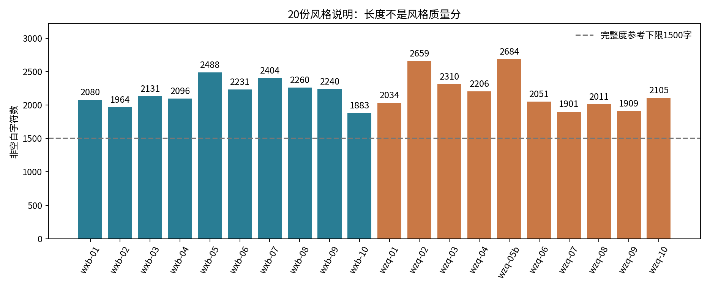

# P2阶段进展：20篇风格说明已完成

截至2026-09-29，王小波和汪曾祺各10篇文章已独立提取风格说明。每篇说明只根据自己的文章生成，没有把其他文章或作者标签交给提取模型。P1的四份结果直接复用。

现在能确认的是：20份结果均已保存、可以追溯到原文和模型响应，说明长度为1883–2684字。不能据此认定模型已经准确掌握作者风格，更不能认定多文章聚合优于单篇。

蓝色wxb是王小波，橙色wzq是汪曾祺。横轴编号与飞书样本清单对应；长度只是说明详尽程度的粗略指标，不能用来排质量名次。4份低于2000字建议目标，但都高于1500字完整度参考；不为凑字重新抽样。

## 本次失败与恢复

批次在19/20完成时中断。《老舍先生》的请求已预留费用，却没有可保存的响应；无法判断平台是否已收费。保留0.143520元未知预留，给恢复请求单独记账，最终补齐第20份。没有重新生成另外19份。

完成20份时，全研究已结算估算费用0.765321元，未知预留0.143520元，合计占用0.908841元。均按官方未缓存单价保守估算，不是账单实付；后续请求的最新金额以usage-ledger.json为准。100元总上限不变。

## 接下来回答什么

先对预选的四篇文章各重复提取两次，观察同一输入会产生多大差异。然后把28份风格说明转换为能追溯引用的规则，逐维比较20份首次结果：同作者90对、跨作者100对。重复提取结果另用于估计波动，不增加作者样本数。

比较前先运行自比、同义改写、相反规则和通用套话控制；控制不通过就记录评估方法失效，不强行出“作者区分成功”的结论。原文句段长度、标点和人称字符计数也已保存，用作补充观察，不当作风格真值。

后续收敛实验的5个抽样顺序和每位作者3篇生成基线已经按固定算法保存，未读取比较评分来选样。聚合、收敛和生成实验尚未完成。

## 验证与入口

234项Rust库测试通过，10项真实API测试按默认规则忽略。恢复、未知费用保留、缓存复跑与跨run复用均有测试。实现提交：7ee3dfa。

- 原始结果：`runs/p2-detailed-single-01/`
- 原文程序统计：`reports/source-description-v1/`
- 抽样清单：`datasets/sampling-v1.json`
- [飞书研究看板](https://my.feishu.cn/base/Jkvpbe5DUaBDZSsQJ7KcRuSSnXe)

报告只描述已完成的首次提取里程碑；持续实验状态以`.claude/tasks/current.md`及各run的summary.json为准。
